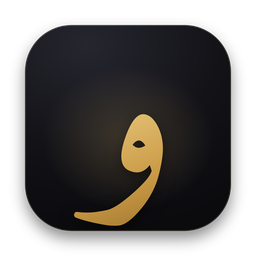

<div align="center">



# Warraq · ورّاق

**A local, GPU-accelerated Arabic OCR & translation studio for books and manuscripts.**

Footnotes · marginal notes (ḥawāshī) · footnotes that continue onto the next page (`=`) ·
searchable PDFs · Word / Markdown / HTML / JSON · local translation · Windows & macOS

</div>

---

Warraq turns scans and PDFs of Arabic books and manuscripts into accurate text. It runs entirely on
your computer, on your NVIDIA GPU (CUDA) on Windows or on the Apple GPU (Metal) on a Mac. Recognition uses
[**Arabic-GLM-OCR-v2**](https://huggingface.co/sherif1313/Arabic-GLM-OCR-v2) (GLM-OCR fine-tuned for
Arabic) together with the **PP-DocLayoutV3** layout detector. A layer of page analysis and self-checking
built specifically for Arabic books sits on top of them.

> *al-warrāq* (الورّاق) was the copyist and book-maker of the classical Arabic world.

## What it does

| | |
|---|---|
| **Input** | PDF (scanned or born-digital), PNG, JPG, TIFF (multi-page), WEBP, BMP, HEIC. Single files, many files, or whole folders. |
| **Text file** | A UTF-8 `.txt` with page separators, a **labelled marginal-notes section** and a **labelled footnotes section** per page (see below). |
| **Searchable PDF** | The original pages, untouched, with an invisible, exact-Unicode Arabic text layer, so you can search and copy. |
| **More formats** | Word `.docx` (right-to-left), Markdown, a reading-view `.html`, and `.json` with every region, line box and confidence. |
| **Translation** | Local translation into 33+ languages, keeping the footnote and margin structure. Writes a translated `.txt` plus bilingual `.txt`, `.html` and `.docx`. |

### The text file

```
========== Page 1 ==========
[Header] مقدمة في علم الحديث - ٥

الحمد لله رب العالمين، والصلاة والسلام على أشرف الأنبياء والمرسلين، وعلى آله وصحبه
أجمعين. أما بعد، فإن علم الحديث من أشرف العلوم وأجلها قدرا، وقد اعتنى به العلماء
قديما وحديثا (١)، فصنفوا فيه المصنفات الكثيرة ...

------marginal notes-------
[M1] (right margin) حاشية: هذا القول منقول عن جماعة من الأئمة

------footnotes-------
[1] انظر: مقدمة ابن الصلاح، ص ١٢، وتدريب الراوي للسيوطي ١/٢٣.
[2] قال الحافظ ابن حجر في هدي الساري: اتفق العلماء على أن أصح الكتب بعد كتاب الله صحيح البخاري.
[3] وقد سار المصنف في هذه الرسالة على طريقة المتقدمين ... من كتب السنة المشهورة، ثم ختم بذكر الموضوع وبيان علاماته ...
```

**Continued footnotes.** In Arabic books a footnote that does not fit on its page continues at the top
of the next page's footnote area after an `=` sign. Warraq detects it in two ways: from the recognised text,
and **visually**, by finding the `=` glyph in the image, so it still works when the model leaves the sign
out. It then **merges the continuation into the footnote it belongs to on the previous page** (as with [3] above)
and removes the `=` signs. If you prefer, choose *Settings → Footnotes → Continued footnotes → Keep on
this page, marked as continued* to keep the continuation where it is, labelled `[3 continued]`.

Every label, heading and separator can be changed in *Settings*, for example `[{n}]`, `------footnotes-------` or
`========== Page {n} ==========`.

## How it reads a page

1. **Prepare the page.** Rotate, remove dark scanner borders, split two-page spreads (right page first), straighten
   skewed scans, even out yellowed paper and shadows, and turn the paper's grain and scanner noise clean white
   (only for reading: the searchable PDF keeps your original page images).
2. **Find the parts of the page.** PP-DocLayoutV3 finds blocks. Warraq then:
   - grows each box so it never cuts a line,
   - recovers ink the detector missed,
   - marks narrow blocks beside the main column as **marginal notes**,
   - marks blocks below the footnote rule, or set in smaller type at the foot of the page, as **footnotes**,
   - orders the body text right-to-left, column by column.
3. **Read each region.** Rotated marginal notes are turned level, and both 180° orientations are tried. Text is
   enlarged to a consistent line height and padded with white. Text is read line by line (on a GPU many
   lines at once), which keeps footnote markers like `(٢)` on their own line and never lets the model skip
   or mix lines; reading whole paragraphs as blocks is available in *Settings*. A scrap of one or
   two words (a paragraph's last word, a short note) is set on a canvas as wide as a normal line, which stops
   the model from guessing.
4. **Check everything.** Every reading's line count is compared with the lines visible in the image, runaway loops
   are stopped as they happen (and cut back to a single copy), and invented tails and stray characters from
   unrelated scripts are caught. Anything suspicious is re-read line by line. Every line's length is checked
   against its width, so a line where the model skipped between two identical words, or repeated itself, is
   read again on its own. Every line is also scored token by token: a line holding a letter the model was
   unsure of is read again, a little larger, and the better reading wins. Words that stay uncertain are
   underlined for review, and doubtful regions are flagged.
5. **Assemble.** Footnotes are split into notes and labelled, `=` continuations are merged, marginal notes are
   labelled, and digits are made consistent through the book.

## Requirements

| | Windows 10/11 | macOS |
|---|---|---|
| Recommended | NVIDIA GPU with ≥ 4 GB VRAM (RTX 20-series or newer is ideal) | Apple Silicon (M1–M5), 16 GB unified memory |
| Also works | Any NVIDIA GPU from the GTX 900 series; CPU-only (slow) | 8 GB Macs (slower) |
| Disk | ~6 GB (PyTorch + models) | ~5 GB |

Intel Macs can't run current PyTorch releases. Translation with the default 1.8B model needs about 4 GB more
GPU or unified memory. On smaller GPUs Warraq unloads the OCR model before translating.

**Speed.** A GPU makes the biggest difference. As a rough guide, a full book page (20–25 lines) takes a few
seconds on a recent NVIDIA GPU and somewhat longer on Apple Silicon. Without a GPU, expect two to three minutes
per page on a 4-core CPU. Pages are saved as they finish, and long jobs can be paused and resumed.

## Install

### Windows

1. Download this repository (green **Code** button → *Download ZIP*) and unzip it somewhere permanent, for
   example `Documents\Warraq`.
2. Double-click **`install-windows.bat`**.
   - It installs [uv](https://docs.astral.sh/uv/) and a private Python 3.12, then picks the right PyTorch build for
     your GPU and driver: CUDA 13.0 for RTX 20-series and newer with a recent driver, CUDA 12.6 for older cards,
     or CPU.
   - Then it installs Warraq and creates **Desktop and Start-menu shortcuts**.
3. Start **Warraq** from the shortcut, or with `run-windows.bat`. Use `run-windows-debug.bat` to see the log.

Keep your NVIDIA driver up to date for the fastest CUDA build. To force a build, run
`scripts\install-windows.ps1 -Torch cu126` (or `cu130` / `cpu`) from PowerShell.

### macOS

1. Download and unzip this repository, for example to `~/Warraq`.
2. Double-click **`install-mac.command`**. If macOS says it can't be opened, right-click → *Open*, or run
   `bash install-mac.command` in Terminal.
   - It installs uv, Python 3.12 and PyTorch with Metal support, then creates **`~/Applications/Warraq.app`**
     with its own icon. You can find it in Launchpad and Spotlight.
3. Open **Warraq** from Applications, or run `./run-mac.command`.

### First start

The first time, Warraq offers to download the reading models: Arabic-GLM-OCR-v2 (2.2 GB) and the layout model
(0.1 GB). After that everything works offline, and you can turn on *Settings → Models → Offline mode*. To
download in advance, run `.venv\Scripts\python -m warraq download` (Windows) or
`.venv/bin/python -m warraq download` (macOS). If Hugging Face is blocked where you are, set a mirror in
*Settings → Models*.

## Using it

- **Drop** PDFs or images anywhere in the window, or click the drop zone to browse.
- Pick a **preset** (*Printed book*, *Manuscript*, *Fast draft*, *Maximum accuracy*), the **output formats**,
  and optionally **Translate to …**.
- Watch each page being read live. Regions are outlined by type: body, marginal note, footnote and header. The
  region currently being read shimmers.
- **Review and edit.** Click any region on the page to jump to its text. Edit text in place (it saves automatically),
  then press **Export** to rewrite the files. *Re-read page* runs OCR again, for example after changing a setting.
- The **TXT preview** tab shows exactly what the text file will contain. The **Translation** tab shows the
  translated page.
- Files are written to `Documents/Warraq/<document name>/` (configurable). *Export → Show in folder* opens it.
- Keyboard: **Ctrl/⌘ K** command palette · **Ctrl/⌘ ,** settings · **Ctrl/⌘ O** open · **Ctrl/⌘ E**
  export · **← →** pages.

### Command line

```bash
warraq ocr book.pdf -o out/ -f txt,pdf,docx          # OCR without the GUI
warraq ocr scans/ --preset manuscript --pages 1-20   # a folder, a page range, a preset
warraq ocr book.pdf --translate English              # OCR + translation
warraq ocr book.pdf --set recognition.batch_size=8   # override any setting
warraq info                                          # GPU / model status
warraq download --translator                         # fetch models ahead of time
```

Inside the installed environment `warraq` is `.venv\Scripts\warraq.exe` (Windows) or `.venv/bin/warraq` (macOS).
`python -m warraq …` works too.

## Configuration

*Settings* (**Ctrl/⌘ ,**) has more than 120 options in 11 sections, with search and an *advanced* toggle:

- **Hardware & GPU**: device (CUDA / Metal / CPU), GPU index, precision (bf16/fp16/fp32), attention kernel
  (SDPA / FlashAttention 2), 8-/4-bit quantisation, layout model on CPU, `torch.compile`, CPU threads.
- **Pages & images**: PDF DPI, native resolution for scanned PDFs, page ranges, rotation, spread splitting
  (and reading order), deskew, border removal, enhancement (gentle / strong for aged manuscripts), denoise,
  binarisation.
- **Layout analysis**: whole-page mode, document type, detection threshold, reading order, marginal-note and
  footnote detection, straightening rotated notes, polygon masks, headers/footers/page numbers
  (keep labelled / remove / inline).
- **Recognition**: prompt, decoding (greedy / beam / sampling), granularity (line by line / paragraphs as blocks),
  block sizes, text-height normalisation, token budget, batch size, self-check and retry, re-reading doubtful
  lines (with an adjustable doubt threshold), confidence flagging.
- **Text clean-up**: diacritics, tatweel, presentation forms, digit style, punctuation spacing, quotation marks
  (restore « »), line breaks vs. paragraphs, removal of stray characters from unrelated scripts, and your own
  find-and-replace rules (with regex support).
- **Footnotes**: section heading, label format, numbering (as printed / per page / continuous), label digits,
  continuation markers, merge or mark continuations, strip `=`, rewrite body markers `(١)` → `[1]`.
- **Marginal notes**: heading, label format, side names, placement.
- **Output**: formats, page separator, encoding (optional BOM), line endings, PDF text-layer variant, keep
  original pages, replace an old OCR layer, image quality, downsampling, Word font.
- **Translation**: engine (built-in local model, an **OpenAI-compatible local server** such as Ollama, LM Studio,
  llama.cpp or vLLM, or NLLB/Marian), model, source and target language, style, extra instructions, **glossary**,
  context, chunk size, temperature, bilingual output.

Presets set several options at once. Settings are stored in `%APPDATA%\Warraq\settings.json` (Windows) or
`~/Library/Application Support/Warraq/settings.json` (macOS).

### Translation engines

- **Built-in** (default): [Tencent Hy-MT2-1.8B](https://huggingface.co/tencent/Hy-MT2-1.8B), Apache-2.0,
  33 languages, about 4 GB. For better quality on a big GPU, set the model to `tencent/Hy-MT2-7B`. Any Hugging Face
  chat model also works, for example `Qwen/Qwen3-4B-Instruct-2507`.
- **Ollama / LM Studio / llama.cpp**: choose *OpenAI-compatible server*, set the URL (for example
  `http://localhost:11434/v1` for Ollama, `http://localhost:1234/v1` for LM Studio) and the model name.
- **NLLB-200 / Marian**: classic machine-translation models (`facebook/nllb-200-distilled-600M`,
  `Helsinki-NLP/opus-mt-ar-en`).

## About the searchable PDF

The text layer uses a *glyph-less* font whose character codes **are** the Unicode code points, so copying gives
exactly the recognised characters, with no broken ligatures or presentation forms. Arabic lines are written in
visual order with narrow spaces and zero-width diacritics, which is what PDF viewers expect.

PDF viewers disagree about how to mirror brackets when they reverse right-to-left text. The default (*Standard*)
suits Acrobat, macOS Preview, Firefox and SumatraPDF. If you mostly copy from Chrome or Edge, set *Settings →
Output → PDF text layer flavour → Chrome / Edge optimised*. Searching for words works in all of them either
way, and the `.txt` file is always exact.

Old invisible OCR layers in input PDFs (common in Arabic PDFs found online) are removed, so search hits come only
from Warraq's text. This is configurable.

## Accuracy tips

- Scan at **300–400 DPI**. For scanned PDFs Warraq uses the embedded image at its native resolution.
- Use the **Manuscript** preset for handwritten codices. It reads line by line, enlarges text, enhances aged paper
  and masks regions precisely.
- If a region is flagged *low confidence*, correct it in the editor. Arabic-GLM-OCR is excellent on running text
  but can misread small digits, so check page references in footnotes.
- Keep *Repetition penalty* at **1.0**. Arabic repeats words and diacritics legitimately, and a penalty makes the
  model skip lines.

## Troubleshooting

| Problem | Fix |
|---|---|
| "No NVIDIA GPU detected" on a PC with an NVIDIA card | Update the driver from nvidia.com, then run `install-windows.bat` again. |
| Out of GPU memory | Lower *Recognition → Batch size* to 1, choose *Hardware → Quantization → 8-bit*, or run the layout model on the CPU. |
| The window doesn't open (Windows) | Install the [WebView2 runtime](https://developer.microsoft.com/microsoft-edge/webview2/), or start with `run-windows.bat --browser`. |
| Slow on a Mac | Close other heavy apps; 16 GB+ unified memory is recommended. Precision *float16* is the default on Metal. |
| Logs | `%LOCALAPPDATA%\Warraq\Logs\warraq.log` (Windows) · `~/Library/Logs/Warraq/warraq.log` (macOS). |

## Privacy

Everything runs locally. Nothing is uploaded. Internet access is only used to download models once (or never,
in offline mode with pre-downloaded models).

## Development

```bash
uv venv --python 3.12 && uv pip install torch torchvision && uv pip install -e ".[dev]"
python -m pytest              # unit tests (no models needed)
python -m warraq --browser    # run the GUI in your browser
```

Layout: `warraq/core` (loading, preprocessing, layout, recognition, assembly), `warraq/models` (GPU/device
handling, model wrappers), `warraq/export` (TXT, PDF text layer, DOCX, MD, HTML, JSON), `warraq/translate`,
`warraq/server` (FastAPI + live events), `warraq/web` (the GUI, plain ES modules, no build step).

## Credits & licences

- OCR model: [sherif1313/Arabic-GLM-OCR-v2](https://huggingface.co/sherif1313/Arabic-GLM-OCR-v2) (Apache-2.0),
  fine-tuned from [zai-org/GLM-OCR](https://huggingface.co/zai-org/GLM-OCR).
- Layout model: [PaddlePaddle/PP-DocLayoutV3](https://huggingface.co/PaddlePaddle/PP-DocLayoutV3_safetensors) (Apache-2.0).
- Translation: [Tencent Hy-MT2](https://huggingface.co/tencent/Hy-MT2-1.8B) (Apache-2.0).
- Fonts (bundled, SIL Open Font License): Amiri, Noto Naskh Arabic, IBM Plex Sans Arabic, Inter. See
  `warraq/web/fonts/licenses`.
- Built with PyTorch, 🤗 Transformers, pypdfium2, pypdf, OpenCV, FastAPI and pywebview.
